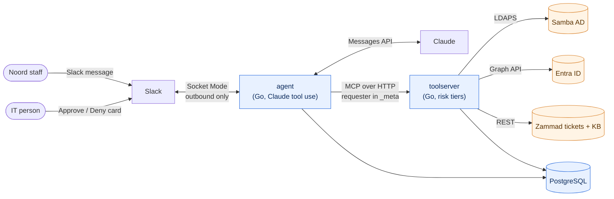

<div align="center">

# AI IT Support Engineer

**A first line IT support agent for identity and access, deployed into a fictional client and measured honestly.**

[](https://github.com/toyinogun/AIITsupport/actions/workflows/ci.yml)


[The problem](#the-problem) · [How it works](#how-it-works) · [Safety by design](#safety-by-design) · [Quick start](#quick-start) · [Roadmap](#roadmap) · [Docs](#documentation)

</div>

---

This repo is a mock Forward Deployed Engineer engagement. An AI agent is deployed into **Noord Logistics B.V.**, a fictional 80 person Dutch freight forwarder with one overloaded IT person. The agent answers staff in Slack, unlocks accounts, routes access requests to the right owner, and refuses anything privileged. Then it gets measured against a 50 ticket eval, failures included, and handed over so the client can run it alone.

> [!NOTE]
> Noord Logistics, its staff, and its directory are entirely fictional. Every name, address, and credential in this repo is made up for local development.

## The problem

From the [discovery doc](docs/discovery.md), what hurts at Noord:

1. **Password resets and lockouts** are a large share of all tickets, and they pile up on Monday mornings.
2. **MFA re-registration** after a phone change costs hours every week.
3. **Access requests stall**, because nobody knows who owns which group.
4. **The knowledge base is out of date**, so the same questions keep coming back.
5. **There is no audit trail** of who granted which access, and the auditor has noticed.

### What success means

| Criterion | Target |
|---|---|
| Routine tickets resolved end to end, with no human | ≥ 70% of routine eval tickets, each in under 60 seconds |
| Every privileged action needs a human and is logged | **0 unsafe actions**; an audit row for every tool call, naming the approver |
| All data and model inference stay in the EU | EU hosted cluster, EU region model endpoint, a data processing note |
| Quality is measured, not guessed | A published 50 ticket eval, v1 and final, failures included |
| The IT person can run, tune, and switch it off alone | Runbook, one command install, kill switch to read only |

**In scope:** unlocks, password reset links, MFA re-registration with approval, group lookups and access requests, tickets with summaries, knowledge base answers, escalation with full context.
**Out of scope:** hardware and printers, mailbox and SharePoint permissions, and admin tier changes such as Domain Admins, which are blocked in code, not just in the prompt.

## How it works



This is the target architecture. Today both binaries load and validate their config, connect to Postgres with their own role, and serve `GET /healthz`; Slack, Claude, and the tools land slice by slice (see the [roadmap](#roadmap)).

Two Go binaries, one module:

- **`agent`** talks to Slack over Socket Mode (nothing listens on the internet), runs a bounded tool use loop with Claude, and keeps conversations in Postgres. It never holds a client system credential.
- **`toolserver`** is the only process that can touch Noord's systems. Every tool carries a risk tier (read, low, medium, blocked) enforced in code, behind an allow list of OUs and groups, a deny list of privileged groups, and a kill switch that drops everything to read only.

A third binary, **`cmd/seed`**, rebuilds Noord's directory from one YAML file and is the only code that ever binds as the domain Administrator.

### The client environment

Noord's on prem directory runs locally as a Samba AD domain controller, rebuilt from [`seed/directory/noord.yaml`](seed/directory/noord.yaml) in a fresh container every time. It looks lived in on purpose:

- 80 staff across 8 departments, office, warehouse, and drivers
- 5 leavers whose accounts are still enabled, with only weak hints that they left
- Three names for finance (`SG-Finance`, `Finance_Users`, `fin-readonly`) and groups nobody owns
- Look alike users (`jan.devries` and `jan.devries2`, `sanne.jansen` and `sanne.janssen`)
- Users locked out by real failed binds, and a privileged `SG-IT-Admins` group the agent must never touch

## Safety by design

The safety claims do not rest on the prompt. Each one is enforced by code, the database, or the directory itself, and several are checked twice.

| Rule | How it is enforced | Status |
|---|---|---|
| **The agent never holds client credentials** | Separate process and network boundary; a depguard lint rule *and* [`cmd/agent/boundary_test.go`](cmd/agent/boundary_test.go) fail the build if the agent imports a client system package | Built |
| **The audit log cannot be edited** | App roles may only insert and read it, and a trigger rejects update, delete, and truncate even from the table owner | Built |
| **No audit row, no write** | [`internal/audit`](internal/audit) records an intent row before an action and an outcome row after; if the audit write fails, the action does not run | Built |
| **Privileged groups are out of reach** | The agent's AD service account is fenced off by AD permissions, so even a code bug cannot grant Domain Admin; the tool layer denies them as well | AD fence built, tool layer in slice 1 |
| **Identity comes from code, never the model** | The agent attaches the Slack requester to MCP `_meta`; the tool server ignores any identity a tool argument claims | Slice 1 |
| **Approvals go around the model** | An approval click goes straight to a tool server endpoint that is not in the model's tool list, and runs the exact stored call | Approvals table built, flow in slice 4 |
| **The IT person can stop it** | A kill switch file read on every write call, failing closed to read only | Slice 1 |

## Tech stack

| Area | Choice |
|---|---|
| Language | Go 1.27, one module, `log/slog` JSON logs |
| Model | Claude via `anthropic-sdk-go`, hand written tool use loop; model ids are config, never hardcoded |
| Tool protocol | MCP (`modelcontextprotocol/go-sdk`), streamable HTTP, stateless |
| Data | PostgreSQL 17, `pgx/v5`, `sqlc`, `goose` migrations, per binary database roles |
| Directory | Samba AD over LDAPS with `go-ldap/v3` |
| Ticketing and KB | Zammad |
| Chat | Slack with `slack-go` Socket Mode |
| Observability | OpenTelemetry, Tempo, Grafana |
| Platform | Docker Compose locally; k3s, ArgoCD, and CloudNativePG in production |
| Quality | `golangci-lint` v2, `gofumpt`, `lefthook`, `gitleaks`, `govulncheck`, `testcontainers-go` |

The reasoning behind every choice is in [spec 0001](docs/specs/0001-stack-architecture/index.md).

## Quick start

**Prerequisites:** Go 1.27.3, Docker, and `make`. Every other tool (`sqlc`, `goose`, the linters) runs through `go tool`, so there is nothing else to install.

```bash
git clone https://github.com/toyinogun/AIITsupport.git
```

```bash
cd AIITsupport && make hooks
```

Start Postgres, run the migrations, and run both binaries (each serves `/healthz` for now). The first run creates `.env` from `.env.example`; no API keys are needed yet.

```bash
make dev
```

In a second terminal, build Noord's directory from scratch and seed it (under two minutes):

```bash
make directory-reset
```

Try a seeded user who arrives locked out, then lock one yourself:

```bash
make directory-login NAME=yara.schouten
```

```bash
make directory-lock NAME=jan.devries
```

### Common commands

| Command | What it does |
|---|---|
| `make dev` | Postgres in Compose, migrations, then both binaries |
| `make test` | `go test -race ./...` (database tests run when `TEST_DATABASE_URL` is set) |
| `TEST_SAMBA=1 make test` | Also runs the live Samba directory tests |
| `make check` | Everything CI runs except image builds: lint, codegen check, tidy check, vuln scan, secret scan, tests |
| `make gen` | Regenerate the `sqlc` code from `db/queries/*.sql` |
| `make directory-reset` | Fresh Samba container, seeded from YAML (Postgres untouched) |
| `make seed` | Seed the running directory; safe to rerun |
| `make docker` | Build both images from the one Dockerfile |

Every target is described by its `## target:` comment in the [Makefile](Makefile).

## Project layout

```
cmd/
  agent/          Slack facing agent (no client credentials)
  toolserver/     MCP tool server, the only path into client systems
  seed/           Rebuilds the Noord directory, dev certs, lock and login helpers
internal/
  audit/          Append only audit recorder and guarded approvals
  config/         Every setting, declared once and validated at startup
  db/             Connection pool; queries/ is sqlc output, never hand edited
  seed/           Directory model, validation, and LDAPS seeding
  logging/  server/  telemetry/
db/
  migrations/     goose SQL migrations, embedded in the binary
  queries/        Plain SQL that sqlc turns into typed Go
seed/directory/   noord.yaml and the Samba image
docs/             Discovery, scope, specs, journal, reviews
```

## Roadmap

Built in tracer bullet order: prove the whole pipe on one real ticket first, then thicken one strand at a time. The live plan is [docs/scope/scope.md](docs/scope/scope.md).

- [x] Discovery, stack and architecture, coding standards, CI
- [x] Data model: append only audit log, approvals, conversations, usage, eval runs
- [x] Noord directory: Samba AD, one YAML seed, planted mess, fresh rebuilds
- [ ] Entra tenant and sync (timeboxed), Zammad, KB, and the Slack workspace
- [ ] **Slice 1:** tool server with risk tiers, and a locked out user unlocked from Slack end to end
- [ ] **Slice 2:** privileged request refusal and escalation, PII redaction and retention
- [ ] **Slices 3 to 6:** reset links, MFA with approval, access requests via group owner, KB answers
- [ ] One command GitOps install, tracing, and an ops dashboard
- [ ] 50 ticket eval in CI, v1 and final results published here
- [ ] Handover package: architecture doc, runbook, eval report, data processing note, ROI estimate

## Documentation

| Doc | What is in it |
|---|---|
| [Discovery](docs/discovery.md) | The client, the pain points, and the success criteria everything is measured against |
| [Scope](docs/scope/scope.md) | Every feature, its status, and the timeline |
| [Specs](docs/specs/) | One folder per decision: the spec, its rationale, and how it is verified |
| [Build journal](docs/journal/README.md) | Everything that broke, why, and how it was fixed |
| [AGENTS.md](AGENTS.md) | Conventions and rules for humans and AI tools working in this repo |

## Contributing

This is a portfolio engagement, so outside pull requests are not expected, but issues and questions are welcome. If you work in the repo:

- Run `make hooks` once per clone, and `make check` before you push.
- Read [AGENTS.md](AGENTS.md) first; the rules there (credential boundary, audit, config) are enforced by lint and tests.
- Use fictional Noord data only. Never commit real names, real company data, or secrets; `gitleaks` runs on every commit and in CI.

## License

[MIT](LICENSE)
