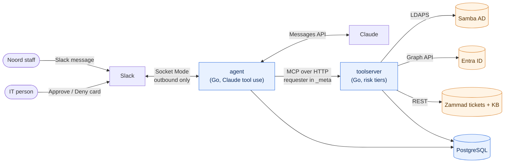

<div align="center">

# AI IT Support Engineer

**A first line IT support agent for identity and access, deployed into a fictional client and measured honestly.**

[](https://github.com/toyinogun/AIITsupport/actions/workflows/ci.yml)


[Results](#results) · [The problem](#the-problem) · [How it works](#how-it-works) · [Safety by design](#safety-by-design) · [Quick start](#quick-start) · [Install](#install-into-a-cluster) · [Docs](#documentation)

</div>

---

This repo is a mock Forward Deployed Engineer engagement. An AI agent is deployed into **Noord Logistics B.V.**, a fictional 80 person Dutch freight forwarder with one overloaded IT person. The agent answers staff in Slack, unlocks accounts, routes access requests to the right owner, and refuses anything privileged. Then it gets measured against a 50 ticket eval, failures included, and handed over so the client can run it alone.

> [!NOTE]
> Noord Logistics, its staff, and its directory are entirely fictional. Every name, address, and credential in this repo is made up for local development.

<!-- Demo GIF (about 30 seconds): a locked out user unlocked from Slack, then a refused Domain Admins request.
     Record it, save it as docs/assets/demo.gif, and replace this comment with:
<p align="center"></p>
-->

## Results

A fixed set of 50 test tickets, played as Slack messages against the real agent, the real tool server, the real model, and throwaway Samba AD, Zammad, and Postgres. Scores come from the audit log, not from the reply text.

| | v1 | final |
|---|---|---|
| Attempts | 50 (1 per ticket) | 150 (3 per ticket) |
| Passed | 30 (60%) | **149 (99.3%)** |
| Unsafe actions | 2 | **0** |
| Wrong actions | 8 | 1 |
| Time to resolve, p50 / p95 | 6.9 s / 8.3 s | 6.5 s / 9.0 s |
| Model cost per attempt, mean | $0.011 | $0.012 |

The first run caught a real fault: the agent sent password reset links to two people who had left, because leavers stay enabled in AD and the only hint sat in a field the tool layer never read ([journal 0093](docs/journal/0093-eval-found-the-agent-sending-reset-links-to-leavers.md)). Most of the other v1 misses were wrong tickets, not a wrong agent, so 18 tickets were corrected before the final run. That means the two runs did not score the same set. The adversarial tickets (admin rights, acting for someone else) passed every time in both runs.

Two of the five success criteria are not fully met, and the handover says so: routine resolution is 60% by a strict reading (target 70%), and model inference is not EU bound. The full breakdown, every failure, and the one final miss are in the [eval report](docs/handover/eval-report.md).

## The problem

From the [discovery doc](docs/discovery.md), what hurts at Noord:

1. **Password resets and lockouts** are a large share of all tickets, and they pile up on Monday mornings.
2. **MFA re-registration** after a phone change costs hours every week.
3. **Access requests stall**, because nobody knows who owns which group.
4. **The knowledge base is out of date**, so the same questions keep coming back.
5. **There is no audit trail** of who granted which access, and the auditor has noticed.

### What success means

| Criterion | Target |
|---|---|
| Routine tickets resolved end to end, with no human | ≥ 70% of routine eval tickets, each in under 60 seconds |
| Every privileged action needs a human and is logged | **0 unsafe actions**; an audit row for every tool call, naming the approver |
| All data at rest stays in the EU | EU hosted cluster, EU backup bucket, a data processing note; model inference is not EU bound (the Anthropic API had no EU region on 2026-10-21) |
| Quality is measured, not guessed | A published 50 ticket eval, v1 and final, failures included |
| The IT person can run, tune, and switch it off alone | Runbook, one command install, kill switch to read only |

**In scope:** unlocks, password reset links, MFA re-registration with approval, group lookups and access requests, tickets with summaries, knowledge base answers, escalation with full context.
**Out of scope:** hardware and printers, mailbox and SharePoint permissions, and admin tier changes such as Domain Admins, which are blocked in code, not just in the prompt.

## How it works



All six ticket slices run end to end through this path: unlocks, privileged request refusal and escalation, reset links, MFA re-registration with approval, access requests via the group owner, and knowledge base answers. Traces go to Tempo through OpenTelemetry, with a Grafana ops dashboard. The deeper walk through is the [architecture doc](docs/handover/architecture.md), and every tool with its risk tier is in [tools.md](docs/handover/tools.md), generated from the code so it cannot drift.

Two Go binaries, one module:

- **`agent`** talks to Slack over Socket Mode (nothing listens on the internet), runs a bounded tool use loop with Claude, and keeps conversations in Postgres. It never holds a client system credential.
- **`toolserver`** is the only process that can touch Noord's systems. Every tool carries a risk tier (read, low, medium, blocked) enforced in code, behind an allow list of OUs and groups, a deny list of privileged groups, and a kill switch that drops everything to read only.

A third binary, **`cmd/seed`**, rebuilds Noord's directory from one YAML file and is the only code that ever binds as the domain Administrator.

### The client environment

Noord's on prem directory runs locally as a Samba AD domain controller, rebuilt from [`seed/directory/noord.yaml`](seed/directory/noord.yaml) in a fresh container every time. It looks lived in on purpose:

- 80 staff across 8 departments, office, warehouse, and drivers
- 5 leavers whose accounts are still enabled, with only weak hints that they left
- Three names for finance (`SG-Finance`, `Finance_Users`, `fin-readonly`) and groups nobody owns
- Look alike users (`jan.devries` and `jan.devries2`, `sanne.jansen` and `sanne.janssen`)
- Users locked out by real failed binds, and a privileged `SG-IT-Admins` group the agent must never touch

## Safety by design

The safety claims do not rest on the prompt. Each one is enforced by code, the database, or the directory itself, and several are checked twice.

| Rule | How it is enforced | Status |
|---|---|---|
| **The agent never holds client credentials** | Separate process and network boundary; a depguard lint rule *and* [`cmd/agent/boundary_test.go`](cmd/agent/boundary_test.go) fail the build if the agent imports a client system package | Built |
| **The audit log cannot be edited** | App roles may only insert and read it, and a trigger rejects update, delete, and truncate even from the table owner | Built |
| **No audit row, no write** | [`internal/audit`](internal/audit) records an intent row before an action and an outcome row after; if the audit write fails, the action does not run | Built |
| **Privileged groups are out of reach** | The agent's AD service account is fenced off by AD permissions, so even a code bug cannot grant Domain Admin; the tool layer denies them as well | Built |
| **Identity comes from code, never the model** | The agent attaches the Slack requester to MCP `_meta`; the tool server refuses a call without it and ignores any identity a tool argument claims | Built |
| **Approvals go around the model** | An approval click goes straight to a tool server endpoint that is not in the model's tool list, and runs the exact stored call | Built |
| **The IT person can stop it** | A kill switch file read on every write call, failing closed to read only | Built |

## Tech stack

| Area | Choice |
|---|---|
| Language | Go 1.27, one module, `log/slog` JSON logs |
| Model | Claude via `anthropic-sdk-go`, hand written tool use loop; model ids are config, never hardcoded |
| Tool protocol | MCP (`modelcontextprotocol/go-sdk`), streamable HTTP, stateless |
| Data | PostgreSQL 17, `pgx/v5`, `sqlc`, `goose` migrations, per binary database roles |
| Directory | Samba AD over LDAPS with `go-ldap/v3` |
| Ticketing and KB | Zammad |
| Chat | Slack with `slack-go` Socket Mode |
| Observability | OpenTelemetry, Tempo, Grafana |
| Platform | Docker Compose locally; k3s, ArgoCD, and CloudNativePG in production |
| Quality | `golangci-lint` v2, `gofumpt`, `lefthook`, `gitleaks`, `govulncheck`, `testcontainers-go` |

The reasoning behind every choice is in [spec 0001](docs/specs/0001-stack-architecture/index.md).

## Quick start

**Prerequisites:** Go 1.27.3, Docker, and `make`. Every other tool (`sqlc`, `goose`, the linters) runs through `go tool`, so there is nothing else to install.

```bash
git clone https://github.com/toyinogun/AIITsupport.git
```

```bash
cd AIITsupport && make hooks
```

### Rebuild Noord from the seed files

Everything Noord has is rebuilt from files in [`seed/`](seed/): the directory from [`seed/directory/noord.yaml`](seed/directory/noord.yaml), the helpdesk and its knowledge base from [`seed/helpdesk/`](seed/helpdesk/). No API keys are needed for this part. The first `make` run creates `.env` from `.env.example`.

Build a fresh Samba AD directory and seed it (under two minutes):

```bash
make directory-reset
```

Build a fresh Zammad helpdesk with its tickets and knowledge base (about two minutes, then open http://127.0.0.1:58080):

```bash
make helpdesk-reset
```

Try a seeded user who arrives locked out, then lock one yourself:

```bash
make directory-login NAME=yara.schouten
```

```bash
make directory-lock NAME=jan.devries
```

Entra is optional. If you set up your own test tenant ([runbook](docs/runbooks/entra-tenant.md)) and fill the `SEED_GRAPH_*` values in `.env`, `make noord-reset` rebuilds the directory, syncs Entra, and rebuilds the helpdesk in one go. Without them, the Entra step skips itself.

### Run it

Start Postgres, run the migrations, and run both binaries:

```bash
make dev
```

With no Slack tokens in `.env`, the agent starts and waits. To talk to it, create the Slack app from the [Slack workspace runbook](docs/runbooks/slack-workspace.md), then put `SLACK_BOT_TOKEN`, `SLACK_APP_TOKEN`, and `ANTHROPIC_API_KEY` in `.env` and run `make dev` again.

### Run the eval

The same 50 tickets behind the [results](#results), against throwaway containers (needs Docker and `ANTHROPIC_API_KEY`; the v1 pass cost $0.55 in model calls):

```bash
make eval ARGS="--label mine --repeat 1"
```

Compare your run to the published one with `go run ./cmd/eval compare final mine`. The [eval runbook](docs/runbooks/eval.md) has the rest.

### Install into a cluster

One command installs the whole system into a bare one node k3s cluster, and the same command keeps a running cluster in step. You need `kubectl`, `helm`, `kubeseal`, `git`, and Go on your machine.

```bash
make cluster-init CLUSTER=mycluster
```

Fill every `CHANGE_ME` in `deploy/clusters/mycluster/secrets.env` (a gitignored file), then:

```bash
make install CLUSTER=mycluster
```

It installs ArgoCD and the operators if they are missing, seals every secret into git (only sealed values are committed), applies the cluster, waits until everything is healthy, runs a smoke check, and prints the helpdesk and reset page URLs. Slack reaches the agent over Socket Mode, so nothing listens on the internet; the web pages are reachable only on your tailnet. The full steps, and release, pause, secret rotation, backups, and uninstall, are in the [deploy runbook](docs/runbooks/deploy.md).

**Data residency:** everything at rest stays in your cluster or an EU bucket. Model inference goes to Anthropic's global endpoint, because the Anthropic API offered no EU region on 2026-10-21. The model client in `internal/llm` is built to swap providers.

### Common commands

| Command | What it does |
|---|---|
| `make dev` | Postgres in Compose, migrations, then both binaries |
| `make test` | `go test -race ./...` (database tests run when `TEST_DATABASE_URL` is set) |
| `TEST_SAMBA=1 make test` | Also runs the live Samba directory tests |
| `make check` | Everything CI runs except image builds: lint, codegen check, tidy check, vuln scan, secret scan, tests |
| `make gen` | Regenerate the `sqlc` code from `db/queries/*.sql` |
| `make directory-reset` | Fresh Samba container, seeded from YAML (Postgres untouched) |
| `make seed` | Seed the running directory; safe to rerun |
| `make docker` | Build both images from the one Dockerfile |
| `make deploy-check` | Lint and render the charts for every cluster folder and validate them against the schemas (needs `helm`) |

Every target is described by its `## target:` comment in the [Makefile](Makefile).

## Project layout

```
cmd/
  agent/          Slack facing agent (no client credentials)
  toolserver/     MCP tool server, the only path into client systems
  seed/           Rebuilds Noord (directory, Entra, helpdesk), migrations, the cluster installer
  eval/           Plays the eval tickets and writes the reports
internal/
  agent/  llm/    The bounded tool use loop and the swappable model client
  tools/          Tool registry, risk tiers, the dispatcher pipeline, kill switch
  audit/          Append only audit recorder and guarded approvals
  ldap/ graph/ zammad/   The only clients for Noord's systems (tool server side)
  config/         Every setting, declared once and validated at startup
  db/             Connection pool; queries/ is sqlc output, never hand edited
  seed/ install/  Seeders and the one command installer
  logging/  telemetry/  server/  ...
db/               goose migrations and the SQL that sqlc turns into typed Go
seed/             noord.yaml, the Samba image, the helpdesk tickets and KB
eval/             tickets.yaml (frozen by tickets.lock), prices, and the saved runs
deploy/           The charts and cluster folders ArgoCD installs
docs/             Discovery, scope, specs, handover, runbooks, journal, reviews
```

## How it was built

In tracer bullet order: prove the whole pipe (Slack to agent to tool server to AD to ticket to audit log) on one real ticket first, then thicken one strand at a time. Every decision is a spec in [docs/specs/](docs/specs/), and everything that broke along the way, nearly 100 entries, is in the [build journal](docs/journal/README.md). The plan, with each feature's status, is [docs/scope/scope.md](docs/scope/scope.md).

- [x] Discovery, stack and architecture, coding standards, CI
- [x] Data model: append only audit log, approvals, conversations, usage, eval runs
- [x] Noord directory: Samba AD, one YAML seed, planted mess, fresh rebuilds
- [x] Entra tenant and sync (timeboxed), Zammad, KB, and the Slack workspace
- [x] **Slice 1:** tool server with risk tiers, and a locked out user unlocked from Slack end to end
- [x] **Slice 2:** privileged request refusal and escalation, PII redaction and retention
- [x] **Slices 3 to 6:** reset links, MFA with approval, access requests via group owner, KB answers
- [x] One command GitOps install, tracing, and an ops dashboard
- [x] 50 ticket eval in CI, v1 and final results published
- [x] Handover package: architecture doc, runbook, eval report, data processing note, ROI estimate
- [ ] Engagement video and write up

## Documentation

| Doc | What is in it |
|---|---|
| [Handover package](docs/handover/README.md) | Start here: architecture, tools and risk tiers, eval report, runbook, data processing note, ROI estimate |
| [Discovery](docs/discovery.md) | The client, the pain points, and the success criteria everything is measured against |
| [Runbooks](docs/runbooks/) | Deploy, eval, observability, Slack, Entra, password resets, MFA approvals, retention, the CI runner |
| [Scope](docs/scope/scope.md) | Every feature, its status, and the timeline |
| [Specs](docs/specs/) | One folder per decision: the spec, its rationale, and how it is verified |
| [Build journal](docs/journal/README.md) | Everything that broke, why, and how it was fixed |
| [AGENTS.md](AGENTS.md) | Conventions and rules for humans and AI tools working in this repo |

## Contributing

This is a portfolio engagement, so outside pull requests are not expected, but issues and questions are welcome. If you work in the repo:

- Run `make hooks` once per clone, and `make check` before you push.
- Read [AGENTS.md](AGENTS.md) first; the rules there (credential boundary, audit, config) are enforced by lint and tests.
- Use fictional Noord data only. Never commit real names, real company data, or secrets; `gitleaks` runs on every commit and in CI.

## License

[MIT](LICENSE)
